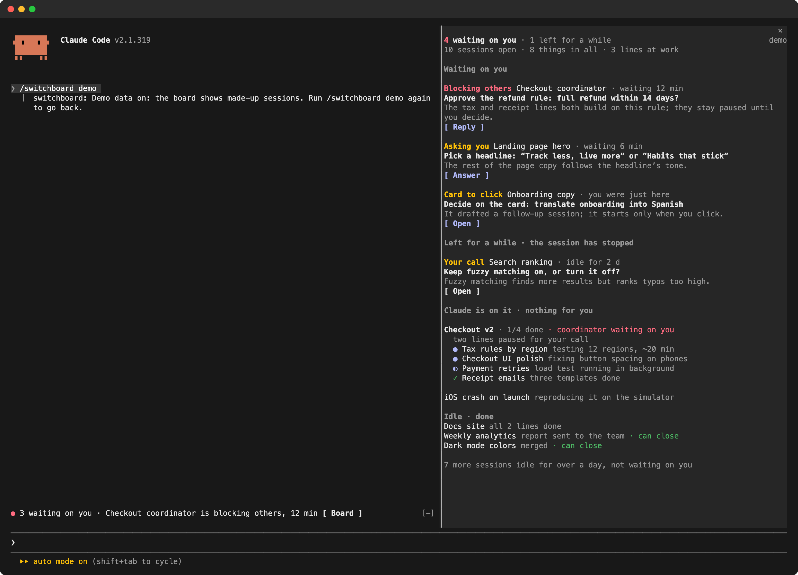

# Switchboard

**See which of your Claude Code sessions are waiting on you, and what each one needs.**

When you run five, ten, fifteen Claude Code sessions at once, the hard part isn't the work. It's remembering which session stopped to ask you something an hour ago. Switchboard keeps a board beside the chat, so the state of every session is on screen instead of in your head.



- **Waiting on you**, most urgent first: a session that is holding up others, then one asking you a question, then one waiting for your call, then a proposed session card nobody clicked. Each shows the one thing to do, why it matters, and a button that takes you there.
- **Left for a while**: sessions that stopped while still waiting on you, so nothing falls through the cracks.
- **Claude is on it**: a coordinator session and the sessions it started, grouped as one project, with each line's state at a glance.
- **Idle · done**: finished work, marked "can close" where nothing is left.
- **A line above the prompt** in every session: `3 waiting on you · Checkout coordinator is blocking others, 12 min [Board]`. It stays there even when the window is too narrow for the board.

## Install

At the prompt of a Claude Code session:

```
/plugin install switchboard --marketplace Fstrategy/switchboard
```

Answer `y` to add the marketplace, then choose a scope (the user scope puts it in every session). The board opens beside the chat when a session starts; `/switchboard` or the **Board** button above the prompt opens it any time.

Needs Python 3 on your PATH (as `python3`, `python` or `py`). Tested with Claude Code 2.1.319 on macOS.

## Try it with made-up sessions

`/switchboard demo` swaps in a made-up afternoon: a checkout redesign split across four sessions, a landing page waiting on a headline, a crash being reproduced. Use it for screenshots and screen recordings without showing your own projects. Run it again to go back.

## How it knows

Switchboard doesn't guess whether a session needs you. It reads records Claude Code already keeps on your machine:

| Record | What it says |
|---|---|
| `~/.claude/sessions/*.json` | which sessions are open, and whether each is working, idle or waiting for your input |
| The Claude desktop app's session records | its own verdict after each turn on whether a person needs to act and what to do, which session started it, session cards still waiting for a click |
| The end of an open session's transcript | its latest reply, and a question still unanswered |

A small model (Claude Haiku, through your own Claude Code login) then writes each session up as a few short lines. Each distinct state is written up once and shared by all your sessions, so ten open sessions don't make ten calls. Turn this off in the settings and the board shows the records' own words instead.

Sessions in a terminal have no verdict from the desktop app. For those, the model reads the last reply and decides whether it asks you something.

## Settings

`/config`, then Switchboard:

| Setting | Default | |
|---|---|---|
| Language | `auto` | `en`, `zh`, or follow your system locale |
| Short lines by a small model | on | off: no model calls at all |
| Open the board | `auto` | `command`: open it only from the Board button or `/switchboard` |
| Footer button | none | a slash command of your own for a button at the bottom of the board |

## Privacy

- Everything is read on your machine. The only thing that leaves it is the short-line requests: a session's title and short excerpts of its latest state (the desktop app's one-line verdict, the latest reply, an open question), sent to Claude through Claude Code itself, the way your sessions already talk to Claude. Turning off short lines stops that too.
- Switchboard writes only to `~/.claude/switchboard/`: the latest facts and the cached short lines. Cache files older than three days are deleted.

## Limits

- Built for the Claude desktop app on macOS, where it is tested. Terminal sessions work too. The Windows and Linux paths are in place but untested; reports are welcome.
- Jumping to a session: desktop sessions open through `claude://` links on every system; terminal sessions only in macOS Terminal.
- The desktop app's session records are not a public interface. If an update changes them, the board may miss things until Switchboard catches up. When it can't read a record, it says so instead of guessing.

## Develop

```
claude plugin validate .
claude plugin test .
python3 -m unittest discover tests
```

`claude --plugin-dir /path/to/switchboard` loads your copy into one session.

Porting it to another agent harness: [docs/PORTING.md](docs/PORTING.md) says what carries over, what to rewrite, and the scenarios a port must pass.

## License

[MIT](LICENSE). Switchboard is a community plugin for Claude Code. It is not made or endorsed by Anthropic.

[中文说明](README.zh-CN.md)
