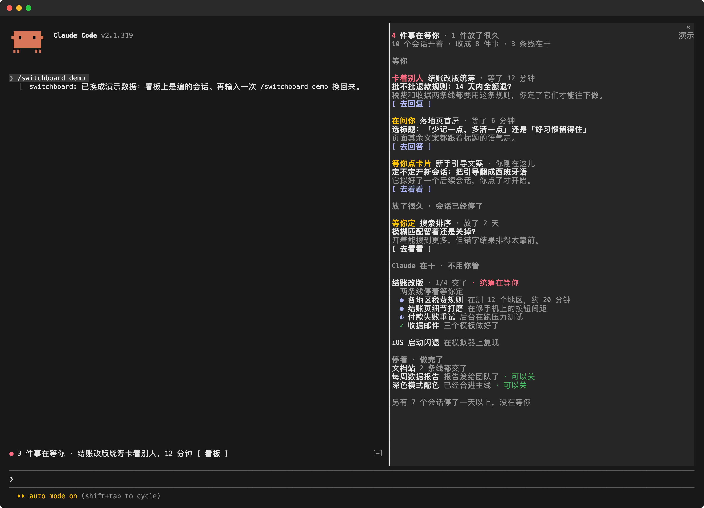

# Switchboard 会话看板

**一眼看清你开着的 Claude Code 会话里，哪几个在等你、各要你做什么。**

同时开五个、十个、十五个会话的时候，难的不是干活，是记住哪个会话一小时前停下来问过你。Switchboard 在对话旁边放一块看板，把每个会话的状态摆在屏幕上，而不是装在你脑子里。



- **等你**：最急的在前。卡着别人的、在问你的、等你定的、等你点卡片的，每件写清要你做的那一个动作、为什么，点按钮直接跳过去。
- **放了很久**：停下时还在等你的会话单独一组，不会被忘掉。
- **Claude 在干**：统筹会话和它派出去的会话收成一个项目，每条线干到哪一眼看清。
- **停着 · 做完了**：做完的往下沉，没剩事的标「可以关」。
- **输入框上方一行**：每个会话里都有，比如「3 件事在等你 · 结账改版统筹卡着别人，12 分钟 [看板]」。窗口太窄放不下看板时它也在。

## 安装

在 Claude Code 会话的输入框里：

```
/plugin install switchboard --marketplace Fstrategy/switchboard
```

按 `y` 添加来源，再选范围（选用户范围就是每个会话都有），设置页直接用默认值就行，以后在 `/config` 里也能改。会话开始时看板自动在旁边打开；随时可以输入 `/switchboard` 或点输入框上方的「看板」打开。

需要电脑上有 Python 3（`python3`、`python` 或 `py` 任一）。在 macOS 上用 Claude Code 2.1.319 测过。

## 用演示数据看看

输入 `/switchboard demo`，看板换成一个编造的下午：结账改版分给四个会话、落地页等你选标题、一个闪退在复现。截图、录屏时用它，不会露出你自己的项目。再输入一次换回来。

## 它怎么知道

Switchboard 不猜。它读 Claude Code 本来就存在你电脑上的记录：会话开着没有、在干活还是在等你；桌面版每轮结束后自己判断的「要不要人动手、做什么」；哪个会话是谁派出去的；还没点的会话卡片；开着的会话最后一条回复和没回答的问题。

然后用小模型（Claude Haiku，走你自己的 Claude Code 登录）把每个会话写成几句短话。同样的内容只写一次、所有会话共用。可以在设置里关掉，关掉后看板直接显示记录里的原话。

## 设置

`/config` 里找 Switchboard：语言（自动 / 英文 / 中文）、要不要用小模型写短句、看板自动打开还是只在点按钮时打开、看板底部放一个你自己的命令按钮。

## 隐私

- 全部在你电脑上读。唯一离开电脑的是写短句的请求：会话标题和最新状态的几段摘录，经 Claude Code 自己发给 Claude，跟你的会话平时一样。关掉短句就一点都不发。
- 只往 `~/.claude/switchboard/` 写东西：最新的会话情况和缓存的短句，超过三天的缓存自动删。

## 限制

- 为 macOS 上的 Claude 桌面版做的，也在那上面测过；终端里开的会话也支持。Windows 和 Linux 的路径写了但没测过。
- 跳到会话：桌面版会话在各系统上都能跳；终端会话只支持 macOS 自带的「终端」。
- 桌面版的会话记录不是公开接口，更新后格式变了，看板可能会漏掉一些，直到 Switchboard 跟上。读不到的记录它会照实说，不瞎猜。

## 许可

[MIT](LICENSE)。Switchboard 是社区做的 Claude Code 插件，不是 Anthropic 出品，也没有经过 Anthropic 认可。
